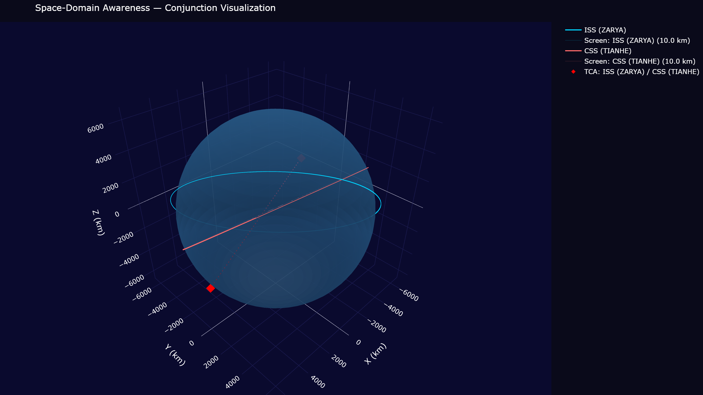
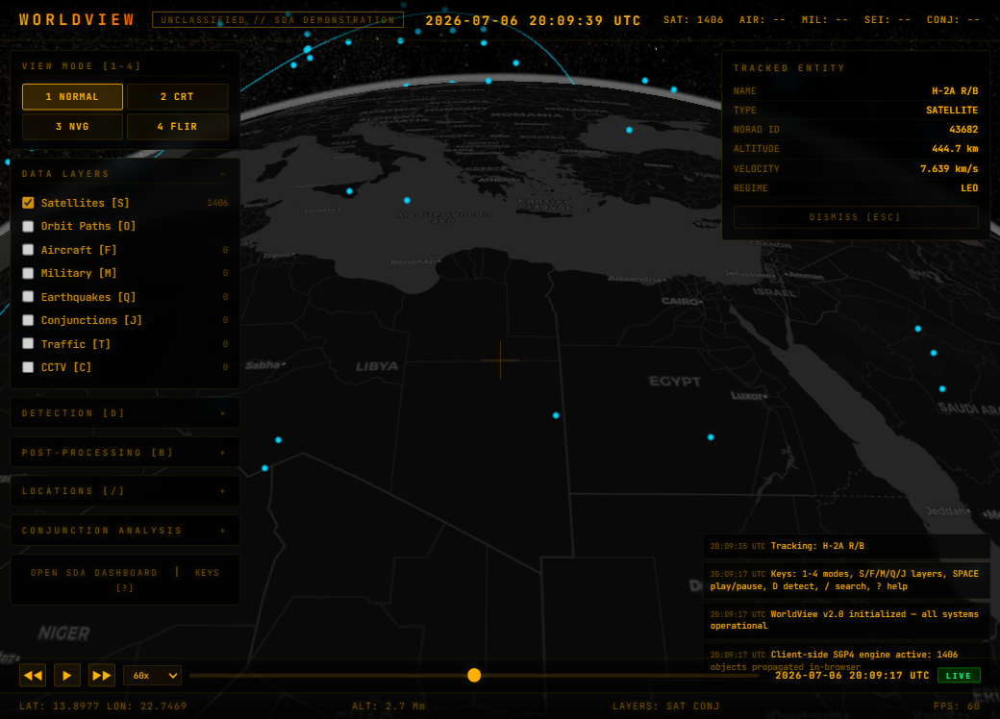
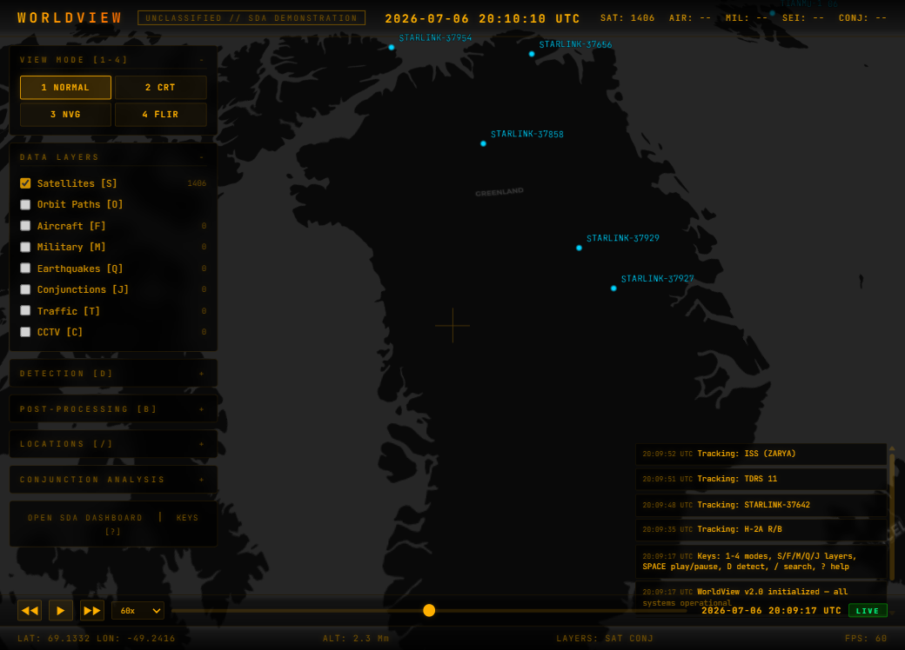
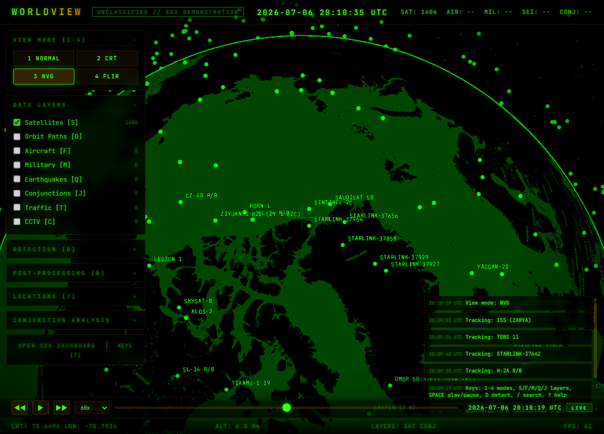
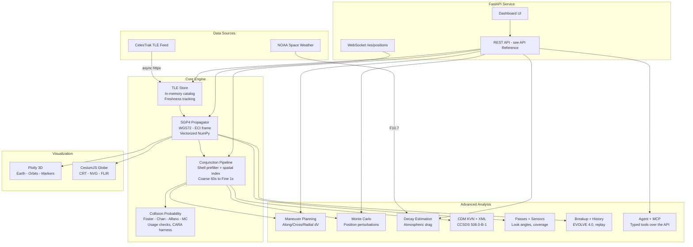

# Space-Domain Awareness Collision Predictor

**Satellite conjunction analysis engine**: SGP4 orbital propagation, full-catalog screening, four collision-probability methods validated against NASA CARA, CCSDS CDM exchange, maneuver planning, pass prediction, breakup and re-entry modelling, an LLM agent front door, and an interactive 3D globe.

**[Open the live demo](https://jdardash.github.io/space-collision-predictor/)**: the WorldView globe running entirely in the browser, propagating a real catalog with client-side SGP4. No backend, no sign-in, nothing to cold-start.

The demo ships a fixed TLE snapshot, so treat the positions as illustrative rather than operational: SGP4 accuracy degrades within a couple of weeks of epoch. For current elements, run the full application with `make docker`, which fetches live CelesTrak data and adds the position feed, conjunction analysis, and the aircraft, seismic, and traffic layers.

[](https://github.com/jdardash/space-collision-predictor/actions)
[](https://python.org)
[](https://pypi.org/project/sgp4/)
[](LICENSE)

---



### WorldView: live catalog globe

1,406 objects propagated client-side, with per-entity tracking, selectable data layers, and time-warp playback.



| Entity tracking | NVG view mode |
| --- | --- |
|  |  |

---

## What It Does

Ingests **Two-Line Element sets (TLEs)** from CelesTrak, propagates orbits with **SGP4**, screens all satellite pairs for close approaches, computes collision probability with TLE-age-scaled covariance, and generates avoidance maneuver options, all served over a FastAPI REST/WebSocket API with a built-in 3D dashboard.

| Feature | Description |
| ------- | ----------- |
| **SGP4 Propagation** | WGS72 gravity model, ECI (TEME) frame, vectorized NumPy batch mode |
| **Two-Phase Conjunction Detection** | Coarse screen (60 s steps) then fine refinement (1 s steps) around candidate TCAs |
| **Full-Catalog Screening** | Apogee/perigee shell prefilter, per-step spatial index (scipy KD-tree or a numpy grid hash), vectorized `SatrecArray` propagation; 5,000 objects in 2.9 s, identical candidate set to all-pairs |
| **Regime Survey and Exclusions** | LEO / MEO / GEO / HEO surveys with per-regime thresholds, formation-flying exclusion table (ISS, CSS, TanDEM-X, Starlink and OneWeb same-launch), composite 0-100 risk score |
| **Collision Probability (Pc)** | Foster 2D quadrature, Chan series, Alfano erf-strip series and Monte Carlo over real 3x3 covariances; TLE-age-scaled sigma when no covariance exists |
| **Pc Usage Checks** | Eight coded warnings (slow encounters, extended encounters, NPD or ill-conditioned covariance, Chan aspect limit, HBR near miss, dilution); CARA-style covariance remediation and realism scaling; maximum Pc with a missing covariance (Frisbee) and the dilution maximum |
| **NASA CARA Validation** | `python -m sda.cara` reruns 53 NASA CARA CDMs and the 11 Alfano 2009 test cases against every method; a CI job |
| **Risk Classification** | Five-level assessment: CRITICAL / HIGH / MODERATE / LOW / NEGLIGIBLE |
| **Maneuver Planning** | Along-track, cross-track, and radial delta-V options per lead time |
| **Monte Carlo Analysis** | Gaussian position-noise miss-distance distributions; cross-check for the analytic Pc |
| **Orbital Decay Estimation** | Harris-Priester-style atmospheric model with F10.7 solar-flux scaling |
| **CCSDS CDM Exchange** | Conjunction Data Messages per CCSDS 508.0-B-1: KVN and XML readers, KVN writer with the Pc method stated, Pc recomputed from the message covariances |
| **Pass Prediction and Sensors** | Observer look angles (azimuth, elevation, range, range-rate), rise / max / set passes with sunlit and shadow flags, a bundled sensor network with field-of-view coverage, geofences and DOP |
| **Breakup and Re-entry** | NASA Standard Breakup Model (EVOLVE 4.0) fragment clouds with Gabbard data and a collision-consequence summary; fragments fitted to TLEs so the cloud screens like any other object; re-entry watch list |
| **TLE History and Replay** | Epoch-keyed element archive (optional JSONL on disk), decay-aware maneuver detection with vis-viva delta-V, historical replay with an optional conjunction screen |
| **Operations** | Space-Track GP, TIP and public-CDM pulls with rate throttling, alert rules with webhook delivery, PDF conjunction reports (optional fpdf2), fleet screening, `/doctor` self-check, Kubernetes manifests |
| **Agent Front Door** | `POST /agent/chat` with nine typed tools (run screening, explain Pc, predict passes, fly the globe) over Anthropic, OpenAI-compatible or Ollama backends, plus an MCP stdio server |
| **Security Posture** | Binds to 127.0.0.1 unless `SDA_HOST` is set, CORS allowlist, token-bucket rate limit on the feed proxies and agent, security headers |
| **3D Visualization** | Plotly Earth + orbits + screening volumes; CesiumJS globe with worker-side SGP4 for the whole catalog, clock-driven time control, share links, covariance shells at TCA, a contacts roster and an installable static demo |
| **Globe Styles and Tactical View** | Five GLSL post-process styles (CRT, night vision, FLIR white-hot / black-hot, noir, snow) with a CSS fallback, detection glow, chase / cockpit / orbit / tour camera modes, fading trails, a screen-space label arbiter, sensor field-of-regard cones with inside-cone highlighting |
| **Live Data** | Async CelesTrak multi-group fetch, NOAA space weather, background refresh |
| **WebSocket Streaming** | Real-time satellite positions (lat/lon/alt/velocity) |

---

## Quick Start

```bash
git clone https://github.com/jdardash/space-collision-predictor.git
cd space-collision-predictor
python -m venv .venv && source .venv/bin/activate  # .venv\Scripts\activate on Windows
pip install -e ".[dev]"
python -m sda.api
```

Open [localhost:8000](http://localhost:8000). The server starts instantly with a bundled demo catalog, then seeds live data from CelesTrak in the background. Interactive API docs at [localhost:8000/docs](http://localhost:8000/docs).

> PyPI publication is planned; until then, install from source as above.

### Windows launcher

```powershell
.\scripts\launch.ps1            # start the server and open the globe
.\scripts\launch.ps1 -SetKeys   # enter API keys once, then start
.\scripts\launch.ps1 -Status    # which keys are set, and which ones can cost money
.\scripts\launch.ps1 -WhatIf    # show the port and the variable names it would use, change nothing
```

The globe and every core feature run with no key at all. The launcher reads optional keys from the Windows user environment (never from a file in the repo), uses a local Ollama model for the agent when one is running, binds the first free port from 8010, and sets `SDA_TLE_CACHE_DIR` so a restart keeps the last good catalog. CelesTrak refuses a repeat download of the same group for two hours, so without that cache a quick restart falls back to the small bundled catalog.

Nothing that can bill reaches the server unless you ask for it. A paid key (Anthropic, OpenAI, Google Maps) is saved under a private `SDA_STORED_` name so other tools on the machine do not pick it up, and it is handed to the server only on a run started with `-AllowPaid`. Without that switch the agent answers from the local model alone, and the launcher's own environment changes are undone when it exits.

### Docker

```bash
docker compose up --build
# -> http://localhost:8000
```

### Make Targets

```bash
make dev        # Install with dev dependencies
make test       # Run tests (fail-fast)
make cov        # Coverage report with HTML output
make lint       # ruff + mypy
make serve      # Start FastAPI dev server
make benchmark  # Run propagation benchmark
make docker     # Build and run via Docker
```

---

## Architecture



### Module Map

| Module | Purpose |
| ------ | ------- |
| `propagator.py` | SGP4 wrapper: `(jd, fr)` Julian date handling, ECI propagation, vectorized NumPy mode |
| `conjunction.py` | Two-phase detection pipeline, risk classification, event history |
| `probability.py` | 2D Pc: encounter-plane projection, Bessel I0 integration, TLE-age sigma scaling, full-covariance Foster/Chan/Monte-Carlo methods |
| `validation.py` | Cross-method Pc validation suite (`python -m sda.validation`) |
| `cara.py` | NASA CARA reference harness over the vendored CDMs and Alfano cases (`python -m sda.cara`) |
| `screening.py` | Shell prefilter, spatial index, vectorized catalog propagation, regime survey, formation exclusions, composite risk score |
| `tle_store.py` | In-memory TLE catalog, 2/3-line parser, freshness tracking |
| `maneuver.py` | Orbital elements extraction, along/cross/radial delta-V options |
| `montecarlo.py` | Gaussian position-noise miss-distance distributions |
| `decay.py` | Atmospheric density model, F10.7 scaling, lifetime estimation |
| `cdm.py` | CCSDS 508.0-B-1 CDM generation, KVN and XML parsing, and Pc from real covariances |
| `passes.py` / `sensors.py` | Observer look angles, pass prediction, sensor network, coverage, fences, DOP |
| `breakup.py` / `rv2tle.py` | NASA Standard Breakup Model, Gabbard data, state-vector to TLE fitter |
| `tle_history.py` / `replay.py` | Epoch-keyed TLE archive, maneuver detection, historical replay |
| `spacetrack.py` / `alerts.py` / `report.py` / `fleet.py` / `doctor.py` | Space-Track client, alert rules, PDF reports, fleet screening, self-check |
| `ratelimit.py` | Token-bucket limiter used by the API middleware |
| `llm.py` / `agent.py` / `mcp_server.py` | Provider chain, typed tool loop, MCP stdio server |
| `constants.py` | Shared WGS72 physical constants (matching SGP4 internals) |
| `visualization.py` | Plotly 3D Earth, orbit traces, screening volumes |
| `routes/` | FastAPI routers: satellites, conjunctions, analysis, system, worldview, pc, passes, history, ops, agent |
| `templates/` | Dashboard and CesiumJS WorldView HTML plus `static/` (SGP4 worker, styles, layers, PWA files) |
| `models.py` | Pydantic data models (TLERecord, StateVector, ConjunctionEvent, ...) |
| `api.py` | App assembly, lifespan, CelesTrak/NOAA background tasks |

---

## API Reference

The dashboard (`GET /`) and the globe (`GET /worldview`) are served as HTML outside the schema. The table below is generated by `python scripts/gen_api_table.py --write`; do not edit it by hand.

<!-- api-table:start -->
73 REST endpoints + 1 WebSocket, with auto-generated docs at **/docs** (Swagger UI) and **/redoc**.

| Method | Endpoint | Description |
| ------ | -------- | ----------- |
| `GET` | `/health` | Health check and system status |
| `GET` | `/metrics` | Performance and operational metrics |
| `GET` | `/space-weather` | Live space weather data from NOAA SWPC |
| `GET` | `/satellites` | List all tracked satellites |
| `DELETE` | `/satellites/{norad_id}` | Remove a satellite from tracking |
| `GET` | `/satellites/{norad_id}` | Get satellite detail with current state vector |
| `GET` | `/satellites/{norad_id}/decay` | Orbital decay and lifetime estimate |
| `POST` | `/tle` | Ingest TLE data |
| `GET` | `/tle/freshness` | TLE freshness report for all satellites |
| `POST` | `/tle/history/snapshot` | Archive element sets for later replay and maneuver detection |
| `GET` | `/tle/history/{norad_id}` | Archived element sets for one object |
| `GET` | `/tle/history/{norad_id}/maneuvers` | Detected maneuvers, decay anomalies and the orbit change log |
| `POST` | `/tle/refresh` | Refresh TLEs from live CelesTrak sources |
| `POST` | `/tle/refresh/spacetrack` | Refresh the catalog from Space-Track.org |
| `GET` | `/tle/stale` | List satellites with stale TLEs |
| `POST` | `/conjunctions` | Run conjunction analysis with collision probability |
| `POST` | `/conjunctions/cdm` | Generate CCSDS Conjunction Data Messages |
| `POST` | `/conjunctions/cdm/ingest` | Ingest a CCSDS CDM and compute Pc from its real covariances |
| `GET` | `/conjunctions/exclusions` | Bundled formation and co-orbiting exclusion table |
| `DELETE` | `/conjunctions/history` | Clear conjunction history |
| `GET` | `/conjunctions/history` | Historical conjunction events |
| `POST` | `/conjunctions/survey` | All-vs-all conjunction survey restricted to one orbit regime |
| `GET` | `/conjunctions/visualize` | Interactive 3D conjunction visualization with screening volumes |
| `POST` | `/maneuver` | Plan collision avoidance maneuver |
| `POST` | `/montecarlo` | Monte Carlo miss distance uncertainty analysis |
| `POST` | `/pc/cdm` | Compute Pc from a CDM in KVN or XML form |
| `POST` | `/pc/compare` | Compare every Pc method on one encounter |
| `POST` | `/pc/dilution` | Scan covariance scale for the maximum achievable Pc |
| `POST` | `/pc/max-missing-covariance` | Upper bound on Pc when one covariance is missing |
| `POST` | `/passes` | Predict ground-station passes |
| `GET` | `/sensors` | Bundled surveillance sensor network |
| `POST` | `/sensors/coverage` | Which sensors can see an object now |
| `POST` | `/sensors/fences` | Sensor fence crossings over a window |
| `POST` | `/lookangles` | Topocentric look angles at one instant |
| `POST` | `/dops` | Dilution of precision for an observer |
| `POST` | `/breakup/simulate` | Simulate a breakup with the NASA standard breakup model |
| `POST` | `/replay` | Replay the catalog at a past epoch |
| `GET` | `/reentries` | Predicted reentries from Space-Track TIP messages |
| `GET` | `/fleet/example` | Example fleet definition (YAML) |
| `POST` | `/fleet/screen` | Screen an operator fleet against the tracked catalog |
| `POST` | `/report` | Conjunction report as a self-contained HTML page or a PDF |
| `GET` | `/alerts/config` | Current alerting configuration |
| `POST` | `/alerts/config` | Replace the alerting configuration |
| `DELETE` | `/alerts/log` | Clear the alert log |
| `GET` | `/alerts/log` | Recently dispatched alerts |
| `POST` | `/alerts/test` | Send a synthetic alert to every webhook |
| `GET` | `/spacetrack/cdm` | Publicly released conjunction data messages from Space-Track |
| `GET` | `/doctor` | Environment diagnostics (offline) |
| `POST` | `/agent/chat` | Ask the orbital engine a question in natural language |
| `GET` | `/agent/health` | LLM provider chain status |
| `GET` | `/agent/tools` | Typed tool catalogue offered to the model |
| `GET` | `/api/ais` | AIS vessel positions in a bounding box (needs AISSTREAM_API_KEY) |
| `GET` | `/api/bikeshare` | GBFS bikeshare stations and live availability |
| `GET` | `/api/cctv` | Public traffic-camera locations and snapshot URLs |
| `GET` | `/api/config` | Optional map-provider tokens for the WorldView frontend |
| `POST` | `/api/conjunction-globe-data` | Conjunction events formatted for CesiumJS globe rendering |
| `POST` | `/api/conjunction-pc-history` | Pc evolution over lead times before TCA |
| `GET` | `/api/earthquakes` | Recent seismic activity from USGS |
| `GET` | `/api/fires` | NASA FIRMS active fire detections (needs FIRMS_MAP_KEY) |
| `GET` | `/api/flights` | Live flight data from OpenSky Network |
| `GET` | `/api/gdelt` | Geolocated news events from the GDELT GEO 2.1 API |
| `GET` | `/api/geocode` | Place search via OpenStreetMap Nominatim |
| `GET` | `/api/launches` | Upcoming orbital launches from Launch Library 2 |
| `GET` | `/api/military-flights` | Live military aircraft from crowdsourced ADS-B (adsb.lol) |
| `GET` | `/api/military-sites` | Military installations in a bounding box from OpenStreetMap |
| `GET` | `/api/radio` | Internet radio stations near a point (Radio Browser) |
| `GET` | `/api/satellite-orbits` | Orbit paths for all tracked satellites |
| `GET` | `/api/satellite-positions` | All satellite positions as lat/lon/alt |
| `GET` | `/api/space-weather` | NOAA SWPC planetary K index, solar wind and active alerts |
| `GET` | `/api/tles` | Raw TLE catalog for client-side propagation |
| `GET` | `/api/traffic` | Road geometry in a bounding box from OpenStreetMap Overpass |
| `GET` | `/api/volcanoes` | Holocene volcanoes from the Smithsonian Global Volcanism Program |
| `GET` | `/api/weather-alerts` | Active National Weather Service alerts (United States) |
| `WS` | `/ws/positions` | WebSocket stream |
<!-- api-table:end -->

---

## Risk Classification

| Miss Distance | Relative Velocity | Risk Level |
| :---: | :---: | :---: |
| < 0.5 km | any | **CRITICAL** |
| < 1.0 km | any | **HIGH** |
| < 5.0 km | > 10 km/s | **HIGH** |
| < 5.0 km | <= 10 km/s | **MODERATE** |
| < 10.0 km | any | **LOW** |
| >= 10.0 km | any | **NEGLIGIBLE** |

---

## Collision Probability

2D short-term-encounter method in the tradition of Foster & Estes (1992), Chan (2008), and Alfano (2005):

1. Project the miss vector onto the encounter plane (perpendicular to relative velocity)
2. Combine per-object position covariances: sigma = sqrt(sigma1^2 + sigma2^2)
3. Integrate the 2D Gaussian over the circular hard-body cross-section (default combined radius 20 m)
4. Radial integration uses the modified Bessel function I0 (Abramowitz & Stegun 9.8.1-2)

**Covariance model:** TLEs carry no covariance, so an isotropic synthetic sigma is used, scaled with TLE epoch age following Vallado (2013, Ch. 9): 50 m for a fresh TLE, growing to ~500 m at 3 days. Note the well-known *probability dilution* property of 2D Pc: for very stale data, larger sigma can decrease reported Pc; miss distance and risk level are therefore always reported alongside Pc.

**Full-covariance path:** when real covariances are available, e.g. from an ingested CCSDS CDM (`POST /conjunctions/cdm/ingest`), Pc is computed from the actual 3x3 per-object RTN covariances instead of the synthetic sigma. Each covariance is rotated to ECI via its object's own state, combined, projected onto the encounter plane, and evaluated with independent methods that are reported side by side: Foster 2D quadrature (adaptive polar grid), the Alfano 2005 erf-strip series with adaptive Simpson intervals and convergence metadata, the Chan analytic series in a cancellation-free summation order that stays accurate into the deep tail (Pc ~ 1e-16), and 2D Monte Carlo. `POST /pc/compare` returns all of them for one encounter.

**Usage checks:** every full-covariance result carries a `PcUsageReport` with coded warnings in the style of CARA's `PcMultiStep`: `LOW_RELATIVE_VELOCITY`, `EXTENDED_ENCOUNTER`, `NPD_COVARIANCE`, `ILL_CONDITIONED_COVARIANCE`, `EXTREME_ASPECT_RATIO`, `CHAN_ASPECT_RATIO`, `HBR_COMPARABLE_TO_MISS` and `PC_DILUTION`. Non-positive-definite covariances are remediated with CARA's clip ladder before use and flagged. `POST /pc/max-missing-covariance` (Frisbee) and `POST /pc/dilution` bound the Pc when one covariance is missing or the data are stale.

**Chan validity:** the Chan series is exact only for isotropic covariances. Measured against the CARA reference set its error grows with the encounter-plane aspect ratio (3% at up to 10:1, near 100% above 100:1), so Foster or Alfano is the reported value and Chan is a cross-check; the `CHAN_ASPECT_RATIO` warning fires when the reduction error estimate exceeds 5%.

---

## Validation & Accuracy

- **Propagation** delegates to [python-sgp4](https://github.com/brandon-rhodes/python-sgp4), which is verified against the official Vallado et al. (2006) reference implementation of SGP4 (agreement to ~0.1 mm). This project pins the **WGS72** gravity model and the `(jd, fr)` split Julian-date convention throughout; shared constants in `constants.py` match `sgp4`'s internal WGS72 values exactly.
- **Frames:** all positions/velocities are ECI (TEME) in km and km/s. Geodetic conversion (WGS84 ellipsoid) is used only for map display, never in conjunction math.
- **Pc cross-method validation:** every Pc implementation shipped by this package is validated against mathematically independent references by `python -m sda.validation` (also a CI gate, with a non-zero exit on any failure). Four computation approaches are compared across 11 scenarios spanning isotropic and anisotropic (up to 10:1 aspect, rotated) covariances and miss distances from 0 to 8 sigma: closed-form solutions, the Chan analytic series (exact for isotropic encounters), Foster 2D quadrature, and Monte Carlo sampling. Measured agreement (this release):

  | Comparison | Regime | Max relative error |
  | ---------- | ------ | ------------------ |
  | Foster quadrature vs. exact series | isotropic, Pc 1e-1 to 1e-16 | 3.7e-6 |
  | Legacy pipeline Pc vs. exact series | isotropic | 1.6e-7 |
  | Foster standard vs. high-resolution grid | anisotropic to 10:1 | 1.6e-6 |
  | Monte Carlo (4e6 samples) vs. reference | Pc >= 1e-5 | within 5 standard errors |
  | Chan series vs. Foster | anisotropic (documented approximation) | 0.2% at 3:1, 13% at 10:1 |

  The Chan anisotropic error is the known equivalent-area approximation error and is why Foster is the primary reported value.
- **NASA CARA reference harness:** `python -m sda.cara` (a CI job) re-propagates 53 CARA CDMs and the 11 Alfano 2009 test cases from the vendored `tests/data/cara/` set (NASA Open Source Agreement 1.3, notice alongside) and compares every method with CARA's own Pc2D and Pc3D outputs. Current result: Foster inside CARA's tolerance band on 53 of 53 cases, Alfano within 5.4e-5 on 11 of 11 literals; the 34 adversarial sample CDMs are kept as strict expected failures that document where 2D Pc is not applicable.
- **Test suite:** 1,550+ offline-deterministic tests covering LEO propagation bounds, Julian-date roundtrips, all risk-classification branches, Pc bounds and Bessel accuracy, cross-method Pc agreement, CDM round-trip parsing, maneuver physics, and every API endpoint via TestClient.

### Benchmark

Measured output of `make benchmark` (Python 3.13, Windows 11, Ryzen-class laptop CPU):

```text
ISS orbit propagation: 1441 steps (24h @ 60s)
  Loop mode:           4.9 ms avg  (4.1 ms best)
  Vectorized mode:     2.0 ms avg  (1.8 ms best)
  Speedup:         2.5x

Fine propagation: 601 steps (10 min @ 1s)
  Loop mode:           1.6 ms avg
  Vectorized mode:     0.7 ms avg
  Speedup:         2.2x

Screening 2 satellites (1 pairs) over 24h:
  Total propagation: 3.4 ms
  Per satellite:     1.7 ms
```

Run `make benchmark` to reproduce on your hardware.

---

## Disclaimer

This tool is for **research and education**. It must not be used as a sole source of truth for operational collision-avoidance decisions:

- TLE-based screening carries **km-level position uncertainty** that grows with TLE age (roughly 1-3 km/day for LEO).
- TLEs provide no covariance; the Pc covariance here is a synthetic empirical model.
- The atmospheric decay and maneuver models are simplified first-order approximations.

Operational conjunction assessment uses owner/operator ephemerides, calibrated covariances, and validated tools (e.g., NASA CARA). See [SECURITY.md](SECURITY.md) for the safety-critical component list.

---

## Testing

```bash
pytest tests/ -x --tb=short          # Fast, fail-first
pytest tests/ --cov=src/sda          # With coverage
make lint                            # ruff + mypy
```

| Module | Coverage Target |
| ------ | --------------- |
| propagator | 90% |
| tle_store | 90% |
| conjunction | 85% |
| probability | 85% |
| api | 80% |
| maneuver / decay / montecarlo | 80% |

---

## Deployment

Kubernetes manifests live in `deploy/` (see `deploy/README.md`). Set `SDA_HOST=0.0.0.0` in containers; the default bind is loopback.

```bash
# Railway
railway login && railway init && railway up

# Fly.io
fly launch && fly deploy
```

The `Dockerfile` includes a container health check. No environment variables are required; the app starts with a bundled demo catalog and seeds live CelesTrak data in the background.

---

## Tech Stack

| Component | Library | Purpose |
| --------- | ------- | ------- |
| Propagation | **sgp4** | NORAD SGP4/SDP4 (WGS72 gravity) |
| Numerics | **NumPy** | Vectorized orbital computations |
| API | **FastAPI** + **Uvicorn** | Async REST + WebSocket |
| Validation | **Pydantic** | Data models + serialization |
| HTTP Client | **httpx** | Async CelesTrak/NOAA integration |
| 3D Viz | **Plotly** | Interactive orbit visualization |
| Globe | **CesiumJS** (CDN) | WorldView globe, worker-side SGP4 via satellite.js |
| Optional | **scipy** (`[screening]`), **fpdf2** (`[reports]`) | KD-tree screening index, PDF reports; both degrade cleanly when absent |

---

## References

- D. Vallado, P. Crawford, R. Hujsak, T.S. Kelso, "Revisiting Spacetrack Report #3," *AIAA/AAS Astrodynamics Specialist Conference*, 2006 (AIAA 2006-6753).
- S. Alfano, "A Numerical Implementation of Spherical Object Collision Probability," *Journal of the Astronautical Sciences*, Vol. 53, No. 1, 2005.
- J.L. Foster and H.S. Estes, "A Parametric Analysis of Orbital Debris Collision Probability and Maneuver Rate for Space Vehicles," NASA JSC-25898, 1992.
- F.K. Chan, *Spacecraft Collision Probability*, The Aerospace Press, 2008.
- D. Vallado, *Fundamentals of Astrodynamics and Applications*, 4th Ed., Microcosm Press, 2013.
- M. Abramowitz & I. Stegun, *Handbook of Mathematical Functions*, Dover, 1965. Section 9.8 (Bessel functions).
- CCSDS 508.0-B-1, *Conjunction Data Message*, Recommended Standard, 2013.
- S. Alfano, "Satellite Conjunction Monte Carlo Analysis," *AAS 09-233*, 2009 (the 11 reference test cases).
- N.L. Johnson, P.H. Krisko, J.-C. Liou, P.D. Anz-Meador, "NASA's New Breakup Model of EVOLVE 4.0," *Advances in Space Research*, Vol. 28, No. 9, 2001.
- M.D. Hejduk and D.E. Snow, "The Effect of Neglecting Covariance Realism on Conjunction Assessment," AAS/AIAA Astrodynamics Specialist Conference, 2018 (covariance realism scaling).
- NASA CARA Analysis Tools, https://github.com/nasa/CARA_Analysis_Tools (NASA Open Source Agreement 1.3; reference data vendored in `tests/data/cara/`).

## Attribution

Parts of this project were adapted from open-source references, each credited in the module docstring: satguard (MIT) for the screening design and covariance realism helpers, orbveil (Apache-2.0) for the CDM XML structure and the exclusion-table design, satvis (MIT) for the worker propagation and PWA setup and gods-eye-view (MIT) for the globe post-processing and camera modes. AGPL and unlicensed projects surveyed in `reference/COMPARISON.md` were used as design references only; no code was copied from them.

## Citing

If you use this software in research, see [CITATION.cff](CITATION.cff) or use GitHub's "Cite this repository" button.

---

## Contributing

See [CONTRIBUTING.md](CONTRIBUTING.md) for development setup, coding standards, and PR guidelines. This project follows the [Contributor Covenant Code of Conduct](CODE_OF_CONDUCT.md). Security policy: [SECURITY.md](SECURITY.md).

---

## License

[MIT](LICENSE)
